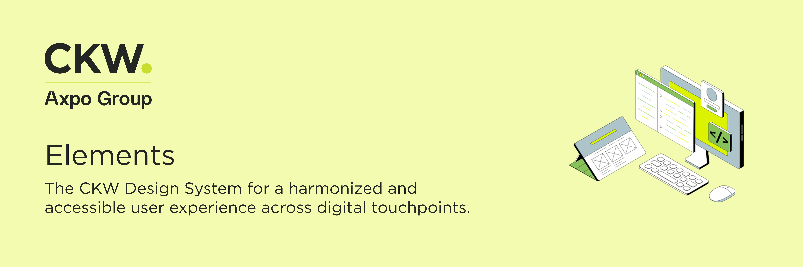

<div align="center">



# CKW Elements

**Design tokens and component library for CKW AG**

[](./LICENSE)
[](https://nodejs.org)
[](https://pnpm.io)
[](https://ckwag.github.io/ckw-elements/)

[Live Documentation](https://ckwag.github.io/ckw-elements/) · [Architecture](./ARCHITECTURE.md) · [Contributing](#contributing)

</div>

---

## Overview

CKW Elements is a design system that bridges Figma and code. Tokens are authored as Figma Variables, exported via Tokens Studio, and transformed into **CSS Custom Properties**, **JavaScript modules**, and **TypeScript declarations** through Style Dictionary v5.

The result: a single source of truth for colors, typography, spacing, borders, shadows, and React components that can be consumed directly from npm packages.

## What's Included

| Package                                         | Status    | Description                                                 |
| ----------------------------------------------- | --------- | ----------------------------------------------------------- |
| [`@ckwag/elements-tokens`](./packages/tokens)   | ✅ Active | Design tokens (CSS + JS + DTCG JSON)                        |
| [`@ckwag/elements`](./packages/components)      | ✅ Active | React component library (ESM + types + CSS)                 |
| [`@ckwag/elements-icons`](./packages/icons)     | ✅ Active | React SVG icon set (ESM + types)                            |
| [`@ckwag/elements-storybook`](./apps/storybook) | ✅ Active | [Documentation site](https://ckwag.github.io/ckw-elements/) |

## Quick Start

```bash
git clone https://github.com/CKWAG/ckw-elements.git
cd ckw-elements
pnpm install
pnpm --filter @ckwag/elements-storybook run dev
```

> **Prerequisites:** Node.js >= 22, pnpm >= 10

Storybook opens at [localhost:6006](http://localhost:6006) with the full token documentation.

## React Usage

Install the packages in any React application:

```bash
npm install @ckwag/elements-tokens @ckwag/elements-icons @ckwag/elements
```

> **SSR limitation:** `@ckwag/elements` does not currently support server-side rendering. In frameworks such as Next.js, render CKW Elements components client-side only; a `'use client'` directive alone does not disable Next.js prerendering.

> **Development builds:** To use the latest unreleased version from `main`, install with the `dev` tag:
>
> ```bash
> npm install @ckwag/elements-tokens@dev @ckwag/elements-icons@dev @ckwag/elements@dev
> ```

Import token CSS once in your app entry point:

```css
@import '@ckwag/elements-tokens/tokens.css';
```

If your bundler does not process package CSS side effects, import component CSS explicitly after the tokens:

```css
@import '@ckwag/elements-tokens/tokens.css';
@import '@ckwag/elements/styles.css';
```

Apps that use cascade layers can opt in to layered CSS exports:

```css
@layer ckw-tokens, ckw-elements, app;
@import '@ckwag/elements-tokens/tokens.layered.css';
@import '@ckwag/elements/styles.layered.css';
```

Then import components directly:

```tsx
import React from 'react';
import { IconSearch } from '@ckwag/elements-icons';
import {
  Button,
  InlineMessage,
  InputField,
  PasswordInput,
  SegmentedControl,
} from '@ckwag/elements';

export function Example() {
  return (
    <form>
      <InlineMessage status="info" title="Statusmeldung">
        Hier steht eine kurze Erklaerung zum aktuellen Status oder zur naechsten Aktion.
      </InlineMessage>
      <InputField label="Name" placeholder="Enter name" icon={<IconSearch size={20} />} />
      <PasswordInput label="Password" name="password" required autoComplete="current-password" />
      <SegmentedControl
        segments={[
          { value: 'monthly', label: 'Monthly' },
          { value: 'yearly', label: 'Yearly' },
        ]}
        activeValue="monthly"
      />
      <Button variant="primary">Save</Button>
    </form>
  );
}
```

## Token Usage

Import the token CSS file into your project:

```css
@import '@ckwag/elements-tokens/tokens.css';
```

Then use semantic tokens in your styles:

```css
.card {
  background: var(--background-default);
  color: var(--text-primary);
  border: var(--border-weight-s) solid var(--border-soft);
  border-radius: var(--border-radius-s);
  padding: var(--spacing-l);
  box-shadow: var(--shadow-s);
}

.card:hover {
  border-color: var(--border-hover);
}
```

> **Rule:** Always use semantic tokens (`--interactive-primary`), never primitives (`--color-green-600`). This enables theming and ensures consistency.

CKW also emits `--ckw-*` aliases for semantic color and typography variables to reduce collisions in existing apps. The original unprefixed token names remain supported for compatibility.

## Typography and Fonts

Use the prefixed typography utility classes as the official React-app API:

```tsx
<h1 className="ckw-text-heading-l">Dashboard</h1>
<p className="ckw-text-body-m">Description text</p>
<span className="ckw-text-caption">Helper text</span>
```

Gotham is licensed and is not bundled with CKW Elements. Applications must provide licensed Gotham files themselves using the family name `Gotham`. The token `--font-family-brand` includes the fallback stack `Gotham, "Helvetica Neue", Arial, system-ui, sans-serif` so apps without Gotham still render consistently.

Token values can also be imported from JavaScript:

```ts
import tokens, { interactivePrimary, spacingM } from '@ckwag/elements-tokens';
import rawTokens from '@ckwag/elements-tokens/tokens.json';
```

## AI Agent Support

The repository includes [AGENTS.md](./AGENTS.md) for coding agents. The deployed Storybook also exposes plain-text resources that are easier for agents to fetch than a rendered browser UI:

- `llms.txt` — short entrypoint
- `llms-full.txt` — package usage, component APIs, and rules
- `tokens/tokens.css`, `tokens/tokens.js`, `tokens/tokens.json` — generated token assets
- `skills/ckw-prototyping.md` and `skills/ckw-components.md` — reusable agent prompts

Storybook itself builds as a static web application. It is not server-side rendered per documentation route; for agent workflows, use the static files above and Storybook's generated `index.json` for story metadata.

## Token Architecture

```
Figma Variables
  └─ Tokens Studio ──▸ tokens-raw.json
                              │
                    transform-tokens.mjs
                              │
                              ▾
                        tokens.json (DTCG)
                              │
                     Style Dictionary v5
                              │
                  ┌───────────┴───────────┐
                  ▾                       ▾
            tokens.css              tokens.js
```

Tokens are organized in two layers:

- **Primitive** — Raw values (79 colors, 15 spacing, 7 radii, etc.)
- **Semantic** — Purpose-driven references (`--interactive-primary`, `--text-secondary`, etc.)

See [ARCHITECTURE.md](./ARCHITECTURE.md) for full pipeline details.

## Scripts

| Command                                             | Description                             |
| --------------------------------------------------- | --------------------------------------- |
| `pnpm install`                                      | Install dependencies                    |
| `pnpm tokens:sync`                                  | Full token pipeline (transform + build) |
| `pnpm --filter @ckwag/elements run build`           | Build React component package           |
| `pnpm format`                                       | Format code (Prettier)                  |
| `pnpm format:check`                                 | Check formatting (CI)                   |
| `pnpm --filter @ckwag/elements-storybook run dev`   | Start Storybook                         |
| `pnpm --filter @ckwag/elements-storybook run build` | Build Storybook                         |
| `pnpm -r run build`                                 | Build all packages                      |
| `pnpm release:validate`                             | Validate build, release metadata, pack  |

## Tech Stack

| Tool                                              | Purpose                  |
| ------------------------------------------------- | ------------------------ |
| [pnpm](https://pnpm.io)                           | Monorepo package manager |
| [Style Dictionary 5](https://styledictionary.com) | Token transformation     |
| [React 19](https://react.dev)                     | Component framework      |
| [TypeScript 7](https://www.typescriptlang.org)    | Type safety              |
| [Storybook 10](https://storybook.js.org)          | Documentation            |
| [Vite 8](https://vite.dev)                        | Build tool               |
| [Prettier](https://prettier.io)                   | Code formatting          |

## Contributing

We welcome contributions! Here's how to get started:

1. Clone and install (see [Quick Start](#quick-start))
2. Create a feature branch from `main`
3. Make your changes — Prettier runs automatically on commit via Husky
4. Verify visually in Storybook
5. Open a Pull Request

### Visual regression review

After CI checks succeed, [Chromatic](https://www.chromatic.com/storybook) captures Storybook stories
on pull requests, pushes to `main`, and merge queues and compares them with approved baselines.
The CI workflow can also be started manually from GitHub Actions. Visual changes fail the
**Visual regression** job until reviewed; they are not automatically accepted. Storybook deployment
on `main` waits for the full CI workflow, including Chromatic.

1. Open the Chromatic build linked from the workflow or pull request and inspect the visual changes.
2. Accept intentional changes as baselines, or reject them and push a fix. New stories need review
   as well, even when Chromatic has no previous snapshot to compare.
3. After accepting changes, rerun the failed **Visual regression** job. If UI Review is enabled,
   resolve discussions and obtain the assigned reviewers' approval there too.

Maintainers must create a Chromatic project for this repository, install its GitHub app, enable UI
Review, and add its project token as the GitHub Actions repository secret `CHROMATIC_PROJECT_TOKEN`.
Run the workflow on `main` to establish the initial baseline, then update existing branches from
`main`. Configure `Visual regression` and Chromatic's `UI Review` as required status checks in the
repository's branch protection/ruleset; without those settings, GitHub does not block merging.
Assign default reviewers in Chromatic when approval by specific teammates is required.

Secrets are not available to forked pull requests. A maintainer can review the code and open a pull
request from a branch in this repository to run Chromatic without exposing the token. Pull requests
created by workflows using `GITHUB_TOKEN` do not trigger CI; close and reopen the pull request or
push a commit to it. Chromatic uploads the built Storybook, including its static assets, so ensure
their licensing permits hosting there before enabling the integration.

### Adding a Component

```
packages/components/src/ComponentName/
├── ComponentName.tsx          # React component (semantic tokens only)
├── ComponentName.stories.tsx  # Interactive stories
└── ComponentName.mdx          # Documentation page
```

### Code Style

- 2-space indent, single quotes, semicolons, trailing commas
- `interface` for props (never `type`)
- Named exports, PascalCase filenames
- `import React from 'react'` required in all TSX files

### Token Changes

1. Export from Tokens Studio → save to `packages/tokens/tokens-raw.json`
2. Run `pnpm tokens:sync`
3. Verify in Storybook
4. Commit

## Project Structure

```
ckw-elements/
├── packages/
│   ├── tokens/              Design tokens (CSS + JS output)
│   ├── components/          React component library
│   └── icons/               React SVG icon set
├── apps/
│   └── storybook/           Documentation site
├── ARCHITECTURE.md          Full technical reference
├── PIPELINE.md              Designer-facing guide (German)
└── AGENTS.md                AI agent reference
```

## Further Reading

- **[Live Documentation](https://ckwag.github.io/ckw-elements/)** — Browse tokens and components interactively
- **[ARCHITECTURE.md](./ARCHITECTURE.md)** — Pipeline spec, Style Dictionary config, data flow
- **[PIPELINE.md](./PIPELINE.md)** — Non-technical guide for designers (German)
- **[RELEASE.md](./RELEASE.md)** — Versioning, release validation, and npm publishing process

## License

Licensed under the [Apache License, Version 2.0](./LICENSE).

**Excluded from the open-source license** (see [NOTICE](./NOTICE)):

| Asset                                  | Reason                                                 |
| -------------------------------------- | ------------------------------------------------------ |
| `apps/storybook/public/ckw-logo.svg`   | CKW AG trademark                                       |
| `apps/storybook/public/fonts/Gotham-*` | Commercial font ([Monotype](https://www.monotype.com)) |
